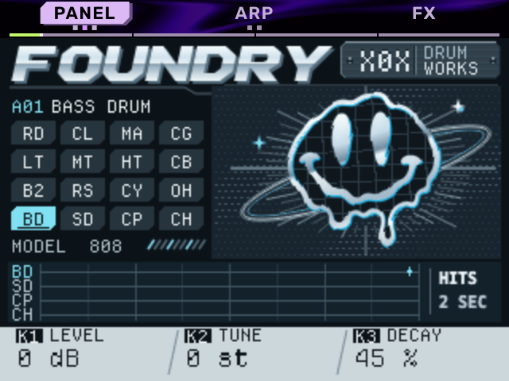
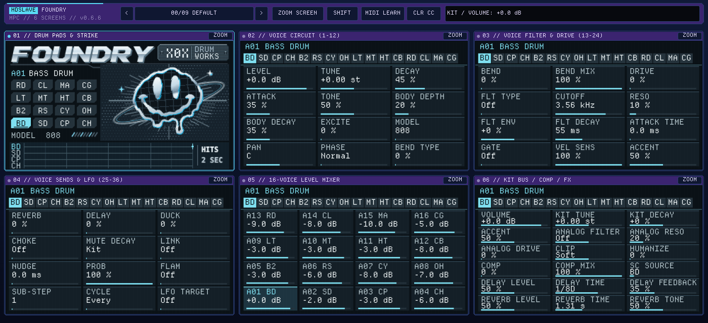

# hdslave Foundry

**A 16-voice 808 / 909 / 606 drum machine with TR-1000-style per-voice shaping as a CLAP plug-in for the Akai MPC Sample.**

<table>
  <tr>
    <th width="34%">MPC Sample</th>
    <th width="66%">macOS and Windows · CLAP</th>
  </tr>
  <tr>
    <td align="center"><a href="docs/foundry-screen.webp"></a></td>
    <td align="center"><a href="mac-clap/assets/desktop-preview.webp"></a></td>
  </tr>
</table>

> **Desktop CLAP version (macOS & Windows):** A separate desktop CLAP build with all MPC screens on one interactive panel lives in [**`mac-clap/`**](mac-clap/) (`cd mac-clap && ./install-macos.sh`). Releases in this repo stay MPC Sample-only for now while the desktop builds are being finalized.

Built for the Akai MPC Sample running [Melodee](https://github.com/keremimo/melodee-sample) / [hdslaveOS](https://github.com/hdslave/hdslaveOS) (64-bit ARM Linux, Cortex-A55). Hosts list it as **hdslave Foundry** (id `com.hdslave.foundry`).

Every pad is a dedicated circuit-modelled drum voice (kick, snare, tom, rim, clap, hat, cymbal, cowbell, claves, maracas) switchable between **808**, **909**, and **606** models — with TR-1000-style analog and circuit-bent (8X/9X) controls, classic hardware-mod controls on the 606 kit (see [The 606 and its mods](#the-606-and-its-mods)), a shared per-voice chain (bend, drive, filter + envelope, amp attack/gate, sends), and per-note performance tools (probability, cycles, flam, sub-steps, nudge), plus reverb, delay, bus compression, and a dedicated kick-only **SC Key** sidechain output for hdslaveOS's master compressor.

Foundry has no internal sequencer — the host plays it directly from the MPC's pads as a kit (carrying the pad map Melodee expects), so Melodee's step sequencer, swing, note repeat, and MOTION drive every voice. Under **hdslaveOS**, it draws the animated **X0X Drum Works** screen with live pad feedback and a 2-second hit timeline.

## hdslave plug-in license

You may use these plug-ins to make, perform, record and sell music, including paid client work, without royalties or credit to hdslave. You may share complete, unchanged official releases for free with their notices intact. Selling the software, including it in a paid product or subscription, or distributing a modified version requires prior written permission from hdslave. Third-party components keep their own licenses. [Full plug-in license](LICENSE.txt).

## The kit

Pads A01-A16 (MIDI notes 36-51), each a voice, from the bottom left along each row and up; **Key Map: GM** moves
them to General MIDI keys instead.

```
  A13 RD   A14 CL   A15 MA   A16 CG
  A09 LT   A10 MT   A11 HT   A12 CB
  A05 B2   A06 RS   A07 CY   A08 OH
  A01 BD   A02 SD   A03 CP   A04 CH
```

| Pad | Note | Voice | Type | Opens as | GM keys |
|---|---|---|---|---|---|
| A01 | 36 | BD Bass Drum | kick | 808 | 36 |
| A02 | 37 | SD Snare Drum | snare | 909 | 38, 40 |
| A03 | 38 | CP Hand Clap | clap | 808 | 39 |
| A04 | 39 | CH Closed Hat | hat | 808 | 42, 44 |
| A05 | 40 | B2 Bass Drum 2 | kick | 909 | 35 |
| A06 | 41 | RS Rim Shot | rim | 808 | 37 |
| A07 | 42 | CY Crash | cymbal | 808 | 49, 52, 55, 57 |
| A08 | 43 | OH Open Hat | hat | 808 | 46 |
| A09 | 44 | LT Low Tom | tom | 808 | 41, 43 |
| A10 | 45 | MT Mid Tom | tom | 808 | 45, 47 |
| A11 | 46 | HT High Tom | tom | 808 | 48, 50 |
| A12 | 47 | CB Cowbell | cowbell | 808 | 56 |
| A13 | 48 | RD Ride | cymbal | 909 | 51, 53, 59 |
| A14 | 49 | CL Claves | clave | 808 | 75, 76, 77 |
| A15 | 50 | MA Maracas | maraca | 808 | 70, 69 |
| A16 | 51 | CG Conga | tom | 808 | 62, 63, 64 |

0.6.0 moved the voices to these pads (before, A01-A16 ran BD, RS, SD, CP, LT, MT, HT, CH, OH, CY, RD, CB, CL, MA, CG,
B2): a pattern recorded on 0.5 or earlier plays other voices now. A saved project's voice settings are kept, as each
voice keeps its parameters.

### Pad banks

The embedded drum map tells hdslaveOS to play Foundry's track as drums: pads A01-A16 send notes 36-51 whatever the
track's octave, key or scale, and the pad names show on the Keys page. On Stage, − / + then move the pad **bank**: bank B
sends 52-67, C 68-83, D 84-99. Since 0.7.0, with **Key Map: Pads** and no Keys Voice, every bank plays the same sixteen
voices at the same sound: a note plays pad (note − 36) mod 16, so 52, 68 and 84 all play the Bass Drum, as do the
notes below 36 (20, 4). Foundry's voices have no pitch per key, so a bank does not transpose them (Tune does that).
Before 0.7.0 every note outside 36-51 was silent. Not yet run on the MPC.

**Keys Voice** (Off, or any voice) keeps its own meaning and wins over the banks: every note outside 36-51 plays that
voice transposed, note 60 being the voice at its own pitch (bank B, notes 52-67, is -8 to +7 semitones; bank C goes on
up). Set it to BD for an 808 bass line (the **808 Bass Keys** preset). **Key Map: GM** is for external MIDI and keeps
the General MIDI keys in the table above (52 is the Crash, 53 the Ride, and keys no list names stay silent); its Keys
Voice plays from 84 up, 96 being its pitch. On the MPC, GM makes pads A01-A16 play GM keys 36-51, not the pads' names.

## X0X Drum Works screen

Foundry uses the Melodee 0.7 screen SDK for its X0X Drum Works panel on Edit and Stage PANEL. The sixteen pads light in playing order.
A kick pushes the chrome face forward, a snare offsets its blue outline, and the metal voices flare the rays.
The four lanes below show the last two seconds of strikes by velocity, including linked voices, flams and sub-steps.
One lane follows the selected pad and the others follow recent voices.

Turn the wheel to select a pad. Push it to audition that voice, including when the transport is stopped.
K1–K3 start on its Level, Tune and Decay. Minus and Plus cycle through the rest of its controls and then the
kit controls. From the first bank, Minus wraps to the last kit bank. The next pad opens on its first bank.
Hold Shift for the control guide. Host automation and pad hits leave the edit focus on the pad you selected.

## The models

Each model follows what is documented of that machine's circuits, and then was fitted to recordings of the machines
themselves: the lengths and levels of the kicks' and toms' first half-cycles, and the spectra and decay points of the
snares, hats, cymbals, claps, cowbell and maracas (see [Sources](#sources)). They are simplified to what is heard and
what the MPC's core affords. Voices a machine never had (a 909 or 606 cowbell, a 606 clap or rim) are new ones in
that model's character.

**808 style.** Bridged-T band passes struck by the trigger, answering in their cosine phase: at full swing the
moment they are struck (the snap), and a second hit adds to a ring still going.

- **Kick.** The centre glides down from about 3.5 times its pitch to 53 Hz over about 4 ms (the attack envelope's
  transistor and retrigger pulse), the first cycles louder. On each negative swing the leakage raises the centre by
  the swing's size and that half swings wider (the sigh), so a loud hit starts sharp and settles. Against the
  recordings, the first eight half-cycles' lengths match within a few per cent: 1.6, 4.1, 7.4, 8.3, 9.4 ms against
  1.7, 3.7, 7.0, 8.2, 9.4. Tone is the pot's low pass over the whole output.
- **Snare.** Two networks at 175 and 330 Hz. At the default Tone the second sits far under the first, as recorded,
  and Tone brings it up. Snappy is white noise through its own envelope, a high pass near 1.2 kHz and a low pass
  near 9 kHz; at full Snappy it rivals the body, as recorded.
- **Toms and conga.** One network each (about 90, 132 and 185 Hz, the conga 215 Hz), whose pitch rides on the ring,
  as the 808's diodes make it: a few per cent sharp while the ring is big, settling as it dies. Only the low tom has
  any pink noise (Color), and little.
- **Rim shot.** Networks at 455 and 1667 Hz through a short, saturating swing-type VCA, with a little noise high
  passed near 3 kHz (the strike's highs). **Claves:** one high-Q network at 2.45 kHz.
- **Clap.** Noise through a band near 1.1 kHz (Nuance narrows it) into two VCAs: the sawtooth envelope's bursts
  (three short, the last longer) and the reverb's envelope (about 0.37 s), then a high pass at 450 Hz.
- **Cowbell.** The 800 Hz oscillator over the 540 Hz one through a band near 900 Hz. Both are rectangles, high
  47.98 % of their cycle as the 808's Schmitt triggers run, which adds the even harmonics between the odd ones.
  An abrupt first fall, then a long quiet second stage (about 20 dB down, Decay).
- **Hats.** The six oscillators (205.3, 304.4, 369.6, 522.7, 540, 800 Hz, the same 47.98 % rectangles, free-running,
  mixed unequally) into the band near 7.6 kHz, then a swing-type VCA. Its clipping is the sizzle. Its diode lets go
  below a share of the envelope, so the closed hat holds then bends down to nothing at about 90 ms, and the open hat
  holds then drops. Then a high pass and the output's differentiator: the spectrum peaks at 8 kHz, as recorded.
- **Cymbal.** Three bands as on the 808: a bright, short top band (a third-order high pass ringing near 10.5 kHz)
  over a long tail from the 7.1 kHz band and a little of the 3.44 kHz band, through swing VCAs, differentiated.
  Tone sets the top band's share.
- **Maracas.** Noise high passed near 7 kHz (rolling off over 12 kHz), swelling over about 11 ms, then falling fast.

**909 style.** Oscillators reset by the hit, through shapers and envelopes.

- **Kick.** A triangle VCO shaped toward a sine, its negative half fuller than its positive, as recorded (Excite
  overdrives the shaper). Its pitch is swept down from about six times its pitch: on the machine Tune sets the sweep's
  time, 5 to 20 ms, here Body Decay. Settles at 53 Hz. The VCA's envelope holds before it falls. The attack is a
  pulse that merges with the first half-cycle, plus a burst of filtered noise.
- **Snare.** Two shaped VCOs near 230 and 320 Hz, each through its own envelope. Their noise goes through a low pass
  (Tone) into a high-passed band (Snappy) and an unfiltered share. It swells in over its first milliseconds (the
  recording's attack is the body) and rings on bright for about half a second.
- **Toms.** VCOs swept down by a pitch envelope.
- **Hats and cymbals.** The ROM voices' path. The metal and plenty of noise, steeply high passed (the cymbals keep a
  low-mid body near 500 Hz, as the recorded crash has), band-limited to the ROM's 13 kHz and falling over the sample's
  own length. Then read as 6-bit words at a 30 kHz clock that Tune moves (Error takes bits away), the words joined
  rather than held (the machine's staircase images are ultrasonic and its low pass takes them; held at the host's
  rate they would fold into the mids), the VCA (Decay) and the DAC's low pass (the ride's brighter). The crash's VCA
  envelope swells and holds before it falls, as recorded. The 909 plays recorded samples here; Foundry synthesizes
  the source.

**606 style.**

- **Kick.** Two networks: the body at 62 Hz with a lighter glide, and a higher, short one for the click (Attack its
  level).
- **Snare.** One main network near 205 Hz, a weak second, strong snappy noise, the whole high passed.
- **Toms.** Higher than the 808's (about 145 and 205 Hz), and the low tom's pitch falls further, about a quarter, as
  recorded.
- **Hats and cymbal.** Its own six oscillators (245, 306, 365, 415, 437, 619 Hz) through a band pass and a high pass
  in parallel, then a high pass. The closed hat decays plainly, as recorded; the open hat and the cymbal add a short
  burst over a long tail, and the open hat's VCA lets go below 30 % of its peak.

## Controls

Melodee lists them in rows of three: the kit's first, then each voice's block (each starts a row with its Level),
then the effects.

### The kit

| Control | Range | |
|---|---|---|
| Volume | -inf to +6 dB | after everything |
| Kit Tune | ±12 st | every voice |
| Kit Decay | ±100 % | every decay, ×0.35 to ×2.8 |
| Accent | 0 – 100 % | how much an accented hit lifts (the TR's accent level), times each voice's Accent |
| Accent Vel | 1 – 127 | a note at least this hard is accented |
| Choke Time | 1 – 200 ms | how fast a choked or gated voice fades (the TR-1000's MUTE DECAY) |
| Clip | Off / Soft / Limit | the TR-1000's master clip |
| Key Map | Pads / GM | see [Pad banks](#pad-banks) |
| Keys Voice | Off / a voice | see [Pad banks](#pad-banks) |
| Step | 1/8 … 1/32 with triplets | the step Sub-Step divides |
| Vel Curve | Soft / Linear / Hard | |
| Humanize | 0 – 100 % | each note up to 8 ms late and up to 25 % softer, its linked voices with it, the same for the same place in the song |

### Each voice

Every voice has Level, Tune (±24 st), Decay, its type's own controls (below), Model, Pan, Phase, and the shared
chain:

| Control | Range | |
|---|---|---|
| Phase | Normal / Inverse | the TR-1000's PHASE: the voice upside down, for layering against another |
| Bend Type, Bend, Bend Mix | 0 – 100 % | the TR-1000's Reformer (RFM TYP, RFM DEP, REFORMER): four characters in a row (fold, rectify, crush, decimate), Bend Type the place between them, Bend the depth, Bend Mix how much of it is heard |
| Drive | 0 – 100 % | |
| Flt Type, Cutoff, Reso | Off / LP / HP / BP, 20 Hz – 20 kHz | |
| Flt Env, Flt Decay | ±6 octaves, 5 ms – 2 s | the filter's envelope, from each hit |
| Attack Time | 0 – 100 ms | a fade in (from silence only, so a retrigger does not click) |
| Gate | Off, 5 ms – 2 s | the TR-1000's hold: the voice fades (Choke Time) this long after the hit |
| Vel Sens, Accent | 0 – 100 % | |
| Reverb, Delay | 0 – 100 % | sends |
| Duck | 0 – 100 % | how far the side chain (SC Source) pushes it down |
| Choke | Off / 1 – 4 | a voice cuts the others in its group; CH and OH are both in group 1. Hit on the same sample by separate notes, the group's voice that comes first in the Link list (BD, RS, SD … CH, OH …) plays and the others' hits on that sample are dropped: CH beats OH, as on the 808 and 909. Voices hit together never cut each other, so a note's linked layers all sound |
| Mute Decay | Kit, 1 – 200 ms | the TR-1000's MUTE DCY: how fast this voice fades when choked or gated; Kit uses Choke Time |
| Link | Off / a voice | also plays when that voice's pad plays (stack B2 under BD: the TR-1000's layers) |
| Nudge | 0 – 80 ms | later (the TR-1000's DELAY, 0 – 3840 samples at 48 kHz) |
| Prob | 0 – 100 % | how likely each hit plays; the same hits drop when the same part of the song plays again |
| Flam | Off, 1 – 60 ms | a grace hit at 45 % of the velocity, then the hit this much later |
| Sub-Step | 1, 2, 3, 4, 6, 8 | the hit split into this many across one Step at the host's tempo |
| Cycle | Every, n/2, n/3, n/4, n/8, 1st Only | plays in the nth of every m bars counted from the song's top (the TR-1000's step cycle, by bars); 1st Only: the first bar after Play. Stopped, it always plays |
| LFO Target, Wave, Rate, Depth | Tune, Decay, Cutoff, Level, Pan, Bend, Drive; sine, triangle, saw, square, random; 8 bars – 1/32 | in step with the song while it plays |

Melodee gives every note of a 128-frame block (about 2.7 ms) that block's first frame, so notes close together land on
one sample. 0.6.2 plays them as the machines would: a voice hit twice on one sample plays the louder hit once, the
accent counted (an accent and a ghost together keep the accent; before, the later hit replaced it on the voices that
set their level from the hit, and the resonators took both strikes), and the open hat no longer cuts a closed hat hit
with it. Hits on different samples (flams, sub-steps, Nudge) play as before. Humanize now moves a note's linked
voices with it; before, each drew its own lateness and softening, so a stacked kick could land up to 8 ms apart.

A voice hit again while it fades (choked, or past its Gate) starts from silence: its tail is gone, not back at full.
Since 0.6.7 the tail's last sample eases out under the new hit over about 2 ms instead of stepping to nothing, which
clicked when the voice has an Attack Time (the new hit rising from zero). A choke or the Gate after the new hit fades
that easing out with the rest of the voice.

### Each type's own

The TR-1000 names where it has the control; *new* where it does not.

| Type | Controls |
|---|---|
| Kick | Attack (808: how far the attack raises the centre; 909: the click's level, its ATTACK; 606: the click network's level), Tone (808: the TONE pot, a low pass over the output; 909 and 606: the click's brightness), Body Depth (808: the sigh's depth; 909: the sweep's depth, its TUNE, 9X P.AMOUNT; 8X BODY DEPTH), Body Decay (808: the glide's time, 1 – 10 ms; 909: the sweep's time, 4 – 34 ms, the machine's TUNE, 9X P.DECAY; 606: the glide and the click's length), Excite (the 8X EXCITE: odd harmonics; on the 909 it overdrives the shaper) |
| Snare | Tone (808: the fundamental/harmonic balance; 909: the noise's low pass), Snappy, Snappy Decay, Detune, Osc Mix, Pitch Env, Pitch Decay, Freq Mod |
| Tom, Conga | Color, Color Tone, Color Decay, Pitch Env, Pitch Decay (*new* on toms), Detune, Osc Mix, Shape, Detail (the 9X tom's: its highs brought out), Attack (*new*: the stick's click), Tone (*new*: a low pass below 0, a high pass above) |
| Rim | Tone, Body, Noise, Freq Mod, Click (*new*), O1 – O3 Tune and O1 – O3 Decay (the 9X rim's: each network's pitch, an octave either way, and its ring, ×¼ to ×4; 50 % as it is; O3 is the 909 style's third) |
| Clap | Claps, Speed, Clap Decay, Mix, Filter, Nuance, Size (the 808's CLAP SIZE: thicker or thinner), Tail Tone (*new*) |
| Hat | Tone, Sculpt, XMod, Blend, Detune, Amp Mod, Error (909: bits below 6; 808 and 606: grit added), Noise (*new*) |
| Cymbal | Tone, Sculpt, Filter, Blend, Detune, Amp Mod, Error, Noise (*new*) |
| Cowbell | Detune, Osc Mix, XMod, Ratio, Noise, Shape, Unison (±12 st, 0 off), Tone (*new*) |
| Claves, Maracas | Attack, Tone (*new*) |

Decay (each voice's) runs over that model's range: for example the 808 kick 0.1 – 5 s to fall 60 dB (the bridged-T's
Q from about 2.3 to 84). The 808 hats' Decay sets the envelope their VCA lets go of: the closed hat lasts about 90 ms
at the default, the open hat about 300 ms.

### The effects

| Control | |
|---|---|
| Reverb Level, Time (0.3 – 12 s), Pre-Delay (0 – 200 ms), Tone, Low Cut (20 Hz – 1 kHz), Mod | eight lines in a feedback network, gently modulated |
| Delay Level, Time (1/32 – 1/2, triplets and dotted, at the host's tempo, up to 2.6 s), Feedback, Tone, Mode (Mono / Ping-Pong / Tape), Delay > Reverb | Tape's saturating loop runs away above about 88 % Feedback, as a tape echo does: it then echoes until turned down. A time changed while it echoes glides there; changed while it is silent (or the tempo while stopped), the next echo comes at the new time and pitch (0.6.2: before, it glided from the old one) |
| SC Source, SC Release | the side chain: see below |
| Comp, Comp Attack, Comp Release, Comp Mix, Comp Key | the bus compressor: Comp sets threshold and ratio together, with makeup |
| Analog Filter, Analog Reso, Analog Drive | the TR-1000's analog FX: one knob from a low pass (left) through off to a high pass (right), then drive |

## The kick into a compressor's side chain

**SC Source** (BD unless set otherwise) is the voice that keys the side chain, three ways:

1. **Duck**: each voice's Duck pushes it down by that much each time the source hits, back over SC Release.
2. **Comp Key: SC Source**: the bus compressor's detector hears the source voice alone instead of the mix, so the
   kick pumps the whole kit through the compressor (no makeup gain in this mode: it only ducks).
3. **The SC Key output**: a second stereo output port carrying the source voice alone, for a host's compressor
   side-chain input.

The key is the voice before its Level, so a kick turned down to -inf in the mix still keys (a "ghost kick").

In Melodee: the master COMPRESSOR's Sidechain is keyed by a track (or one pad of a sample kit). In
[hdslaveOS](https://github.com/hdslave/hdslaveOS) (its `hdslave` branch), a Foundry track as the key is heard through
its SC Key port: the SC Source voice alone, the kick by default, so the mix ducks under the kick and not under every
drum (the COMPRESSOR page names the key, for example "6 SC Foundry"). Stock Melodee keys from the whole track, every
Foundry voice; there, use Foundry's own Duck or Comp Key for kick pumping, or a second Foundry on its own track
playing only the kick.

## The 606 and its mods

The stock 606 has a level knob per voice and a global accent; the popular hardware mods add tune, decay, snappy and
tone controls and a stronger accent. Foundry's 606 models have all of those (Tune, Decay, Snappy, Tone, Accent, and
the hats' decays apart), and the **606 Mods** preset dials them in: tuned and longer drums, more snap, a harder
accent, a little drive and crush.

## Presets

Nine factory presets, inside the plug-in: Melodee lists them on the plug-in's PRESETS page. A preset sets every
control.

| Preset | What it is |
|---|---|
| Default | The kit as it opens: 808 drums, a 909 snare and ride, a 909 second kick |
| 808 Kit | Every voice 808, the kick longer, the toms single-toned, B2 a long boom |
| 909 Kit | Every voice 909: the kick with attack and sweep, a snappy snare, swept toms, gritty hats |
| 606 Kit | Every voice 606, as it comes |
| 606 Mods | The 606 with the classic mods dialled in |
| Bent 808 | 808 with the Reformer-style bends, cross-modulated metal and excited kick |
| Techno 909 | 909 with the kick keying the ducking, the bus compressor, delay and reverb sends, analog drive |
| 808 Bass Keys | 808 with the kick as the Keys voice: a bass line on bank B and up |
| Big Room | 909 with a gated, reverbed snare, swept toms in the reverb, a longer reverb |

## The TR-8S's and TR-1000's drum parameters

Every sound parameter the TR-1000 gives its analog and ACB (8X, 9X) generators and its 606 models is here, by the
names in the table below; the TR-8S's analog-modelled tones have a subset of them (Tune, Decay, BD Attack, SD
Snappy, Tom Color). Effects, sends and routing are left to the host.

| TR-1000 (and TR-8S) | Foundry |
|---|---|
| TUNE, COARSE (every generator) | Tune, ±24 st |
| DECAY; OSC DCY (snares); TAIL DCY (clap) | Decay |
| PHASE; DELAY (0 – 3840 samples) | Phase; Nudge |
| MUTE TRG; MUTE DCY (808 OH) | Choke; Mute Decay |
| 808 BD TONE, 8X BD ATTACK, 909 and 9X BD ATTACK, 606 BD ATTACK | Kick Attack (and Tone, the 808's TONE pot) |
| 8X BD BODY DEP, BODY DCY, EXCITE; 909 BD TUNE, 9X P. AMOUNT, P. DECAY, DRIVE | Kick Body Depth, Body Decay, Excite |
| RFM TYP, REFORMER, RFM DEP (8X BD, SD, toms) | Bend Type, Bend Mix, Bend |
| SD TONE, SNAPPY, SNPY DCY, DETUNE, OSC MIX, P.ENV, P. DECAY, FREQ MOD | Snare Tone, Snappy, Snappy Decay, Detune, Osc Mix, Pitch Env, Pitch Decay, Freq Mod |
| Tom COLOR, COLR TON, COLR DCY, DETUNE, OSC MIX, DETAIL, SHAPE | Tom Color, Color Tone, Color Decay, Detune, Osc Mix, Detail, Shape |
| RS TONE, BODY, NOISE, FREQ MOD, O1 – O3 TUNE, O1 – O3 DECAY | Rim Tone, Body, Noise, Freq Mod, O1 – O3 Tune, O1 – O3 Decay |
| HC CLP SIZE, TAIL LVL, FILTER, CLAPS, SPEED, MIX, CLAP DCY | Clap Size, Mix, Filter, Claps, Speed, Clap Decay |
| CH/OH TONE, SCULPT, XMOD, BLEND, DETUNE, AMP MOD; 9X ERROR | Hat Tone, Sculpt, XMod, Blend, Detune, Amp Mod, Error |
| Crash TONE, SCULPT, FILTER, BLEND, DETUNE, AMP MOD | Cymbal Tone, Sculpt, Filter, Blend, Detune, Amp Mod |
| CB DETUNE, UNISON, OSC MIX, XMOD, NOISE, RATIO, SHAPE | Cowbell Detune, Unison, Osc Mix, XMod, Noise, Ratio, Shape |
| Maracas ATTACK; claves and congas TUNE, DECAY | Maracas Attack; Tune, Decay |
| MODEL (TR-8, TR-08, 8 LONG, TR-09, ATTACK, LOW; LOW/MID/HIGH/FULL) | Model (808 / 909 / 606); the variants are reached with Decay, Attack and Tune |

## Where it differs from the TR-1000, and what is left out

- Hits come from the host: there is no step sequencer, pattern memory, song mode, MOTION or snapshots here (Melodee
  has its own). The TR-1000's step features are applied to notes instead: Prob, Flam, Sub-Step and Nudge per voice;
  Cycle counts bars; Nudge only delays (going early would need latency).
- Per-voice compressors and the eighteen instrument effect types are not there (Bend, Drive, the filter and the bus
  compressor cover the commonest); nor the sampler, PCM, FM and virtual analog engines; nor individual outputs (only
  the SC Key port).
- Layers: the TR-1000's layer tracks (two generators on BD, SD, LT, HT) are done with Link: any voice can sound with
  another's pad.
- The models follow the documented circuits but are not circuit simulations: each is the few parts that make its
  sound (see [Sources](#sources), and the estimates listed there). The 909's hats and cymbals are samples in the
  machine; here they are synthesized and then put through its 6-bit, 30 kHz path.

## Sources

The models were built from the documents below, then fitted to multisampled recordings of a TR-606, a TR-808 and a
TR-909. What was measured:

- **Kicks and toms:** their first half-cycles' lengths and levels, which give the pitch glides, the sighs and the
  asymmetries.
- **Snares, hats, cymbals, claps, cowbell and maracas:** third-octave spectra early and late, and the times to fall
  6, 12, 20, 30 and 40 dB.

Where a recording and a document disagree, the recording won: the 808 snare is at 175/330 Hz, as later 808s are after
Roland's capacitor change, not at the 1981 chart's 238/476 Hz.

- K. J. Werner, J. S. Abel, J. O. Smith III: *A Physically-Informed, Circuit-Bendable, Digital Model of the Roland
  TR-808 Bass Drum Circuit*, DAFx-14. Gives the bridged-T and its Decay feedback, the 1 ms trigger, the raised
  centre for the first milliseconds, the amplitude-driven sigh on the negative swing, and the Tone low pass.
- K. J. Werner, J. S. Abel, J. O. Smith: *The TR-808 Cymbal: a Physically-Informed, Circuit-Bendable, Digital
  Model*, ICMC-SMC 2014. Gives the six oscillators, the 3.44 and 7.1 kHz bands, the three bands and their
  envelopes, the swing-type VCAs' clipping and diode, the high passes, the Tone stage, and the differentiating
  output.
- Roland TR-808 service notes (circuit description and design changes, 1981):
  - the accent's 4–14 V trigger;
  - the kick's doubled frequency for 4 ms;
  - the snare's two networks, its Tone and Snappy, and the later capacitor values;
  - the toms' diode pitch fall, and pink noise on the low tom only;
  - the clap's two VCAs;
  - the cowbell's RC two-stage decay;
  - the hats sharing the cymbal's upper band.
- The 808 kick's pitch in measured samples, a median of 49.5 Hz (arXiv 2502.07524). The recordings used here sit
  at 53 Hz; 808s differ by their parts' tolerances.
- Gordon Reid, *Synth Secrets* (Sound On Sound, 2002), on bass drums, snares, cymbals and cowbells: the 909 kick
  and snare block diagrams, the 909 cymbals' 30 kHz ROM clock.
- Electric Druid on the Boss DR-110, a close 606 relative: its metal bands and decay times.
- The TR-606's six hat oscillator tunings and its two-network kick, as published by others.

Still estimates:

- the 909 toms' pitches;
- the 909 style's metal oscillators (the 909 plays samples; its source here is synthesized and only its spectrum
  and decay were matched);
- the swing VCAs' drive and where their diodes let go (fitted to the decay points, not measured from the circuit);
- the 606 style's mid tom and conga (the 606 has neither).

## Cost

Instructions a 128-frame block takes, from `tools/bench.sh` (callgrind, its default 4-second runs; the
beat's per-block average depends on the run's length, so the duration is part of the figure):

| Case | Instructions | Share of one A55 core at 1 instruction a cycle |
|---|---|---|
| All sixteen voices on every 1/16 with long decays, every effect, the compressor, analog filter and drive | about 583,000 | 12.1 % |
| A beat (kick, snare, hats, clap) with reverb, delay and the compressor | about 129,000 | 2.7 % |
| Stopped | about 3,700 | 0.08 % |

A voice costs nothing once it has died away, and the reverb and delay sleep while they have nothing to play. The
hats' six oscillators are worked out four at a time on the NEON unit while XMod is at 0 (their default). A
voice's shared chain costs nothing while none of it is on, and a send at zero is skipped. The
knobs that move between hits are worked out every 16 samples; the resonators that retune every sample (the kick's
glide and sigh, the toms' diodes) use a short Taylor series instead of full sines. The real share on the MPC depends on how many
instructions the A55 retires a cycle on this code; Melodee's plug-in load figure shows it.

## Build and test

Needs Docker with a Linux arm64 context (Melodee's `colima-melodee` and its `melodee-builder` image by default).

```sh
./build.sh          # build/Foundry.clap, then the tests (tests/host.cpp), the sound's fingerprint and demo renders build/demo-*.wav
./build.sh bench    # build/bench
tools/bench.sh      # instruction counts (Melodee's melodee-profiler image)
./build.sh sanitize # the tests and every fingerprint scenario under AddressSanitizer and UBSan
```

The tests load the plug-in through the CLAP API and check:

- description, ports (the mix and SC Key), note names and the drum map Melodee reads (each pad's voice);
- every parameter's range, text both ways and default, and each voice's block starting a row;
- state save and load (and a state from another version); the presets as preset discovery lists them, each playing;
- every voice in every model sounding, starting on its frame, bounded and ending;
- the recorded character: the 808 kick's short first lobe, its sigh (louder sighs more) and its settled 53 Hz;
  the 909 kick's sweep; the 808 snare's 175 Hz with its 331 Hz far under (Tone bringing it up) and the rim shot's
  455/1667 Hz; the 808 tom's falling pitch; the 808
  hats' energy above 6 kHz; the clap's four bursts 9 ms apart; the 909 metal's held words;
- velocity, accent, choke groups and the host's choke (a voice hit again inside its fade, choked or gated, with no
  step in its output, and choked again 1 ms on, by the host or CC 120 or with its own Mute Decay, with no step larger
  than a choke of the tail alone); hits on one sample (the louder once on the 909 and 808 kicks,
  the closed hat whole and the open one dropped, linked layers in one group both sounding); a voice switched to
  another model carrying nothing over;
- the TR-1000's generator controls: Phase (the voice exactly inverted), Bend Mix (0 the dry voice), Mute Decay, an
  80 ms Nudge, the rim's O1 – O3 Tune and Decay, the toms' Detail, Attack and Tone;
- Prob (the same twice), Cycle, 1st Only, Flam, Sub-Step, Nudge, Humanize, Link, and a linked layer humanized with
  its note;
- the Keys voice's pitch, Tune, Kit Tune, the GM map (every key from 0 to 127: only the keys the table names
  play, so key 0 is silent), MIDI notes;
- the side chain three ways; the reverb, ping-pong delay, analog filter, compressor and Limit; the delay's time
  turned while it sleeps (its next echo on time and at pitch, nothing from before it went quiet);
- the same output whatever the block size (1, 37, 128, 4096 frames, settings and notes on the first frame too);
- every voice ending when its sound does, whatever was played before (the toms' and conga's unheard second network,
  a Model switched between hits, the 909 rim's last network); pitches far past the design range (the Keys voice at
  its top) staying stable; a choke from the host reaching linked voices, and key -1 every voice; Cycle on downbeats
  placed on the nearest frame; the Tape delay at its longest; the 909 kick's coupling the same at 192 kHz;
- finite, bounded output at 36 random and extreme settings at 44.1, 48 and 96 kHz.

`tests/fingerprint.cpp` then renders 94 fixed scenarios (each preset, each voice in each model, the shared chain,
the performance controls, the GM map, the pad banks, the LFOs, the effects and side chain, knobs moving, other block sizes and
rates, stop and a jump, random patches) and hashes every output sample's bits against `tests/fingerprint.txt`: work
meant to keep the sound, such as a speed-up, must leave every hash as it is. A change meant to change the sound
updates them with `make fingerprint-update` (inside the build image). The hashes hold for Melodee's build image and
these compiler flags.

## Install

Copy `build/Foundry.clap` to `Melodee/Plugins/hdslave/hdslave Foundry.clap` on the card, then pick it on an
empty track: Stage, Plugin, hdslave, hdslave Foundry. Its pads become the kit. It needs only libc and libm (glibc 2.35 or
older).

Version 0.7.0: every pad bank (52-99, and the notes below 36) plays the same sixteen voices. Since 0.6.5 it uses the official screen extension on MPC and in the desktop wrapper. hdslaveOS reads the embedded
A01–A16 drum map and can use Foundry’s second stereo output, SC Key, for the master compressor.
Physical MPC testing is pending.
